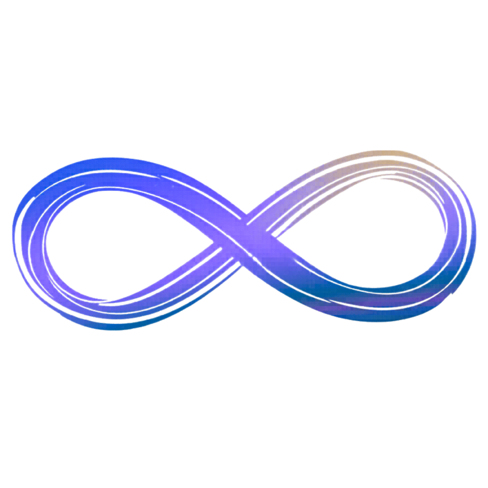

# Continuous ∞

  

  

### O Continuous é um player de pads ambientes para acompanhar seus momentos musicais. Organize álbuns, selecione tonalidades e reproduza seus áudios em loop diretamente no navegador, no computador ou no celular.

# Como Funciona 🎯

- Abra o [Continuous online](https://lucasfujarra.github.io/Continuous/).
- Escolha um **álbum** e clique no **tom** para iniciar a reprodução em loop.
- Clique novamente no tom ou em **Parar** para encerrar com fade-out.
- Use **Adicionar Pad** para importar uma pasta de áudios e confirmar a seleção.
- Os áudios importados ficam salvos **neste navegador**, via IndexedDB, e são restaurados ao atualizar a página. Limpar os dados do site remove essa cópia.
- Personalize **título, cor e capa com emoji** pelo lápis no card. Nos álbuns do sistema, o título é fixo e a exclusão é bloqueada.

# Tonalidades e Áudios 🎹

| Recurso | Funcionamento |
|---------|---------------|
| Maior / Menor | Alterna a exibição entre o tom maior e seu relativo menor, como C → Am, sem alterar o áudio |
| Sustenidos | Arquivos como `Csus.aac` são interpretados como C♯ |
| Formatos | MP3, WAV, OGG, AAC, M4A, MP4, FLAC, OPUS e WEBM |
| Reprodução | Usa o áudio original; o suporte ao codec e a continuidade do loop dependem do navegador e do arquivo |
| Links diretos | `/pad/angel/c` abre o álbum Angel com C selecionado; clique no tom para tocar |

No site publicado, os links incluem a base `/Continuous/`, por exemplo: [Angel · C](https://lucasfujarra.github.io/Continuous/pad/angel/c). Álbuns ou tons inexistentes retornam à home. Álbuns importados só ficam disponíveis nos navegadores em que foram adicionados.

# Funcionalidades 🛠

- 🎵 Reprodução de pads em loop com parada suave
- 📚 Biblioteca organizada por álbuns
- 🎹 Seleção de tonalidades maiores e relativas menores
- 💾 Áudios e personalizações salvos no navegador
- 🎨 Cores personalizadas com ajuste automático do contraste
- 😀 Capas com emojis, busca e categorias em português
- 🌈 Sugestão de cor a partir do emoji escolhido
- 🌊 Ondas desfocadas na cor do álbum, com tamanho ligado ao volume
- 📱 Interface adaptada para computadores e celulares
- 🔗 Navegação por álbum e tom com links diretos

# Tecnologias 🚀

| Tecnologia | Versão | Uso |
|------------|--------|-----|
| Node.js | 22.18+ | Ambiente de desenvolvimento e build |
| React | 19.2.6 | Interface e estado compartilhado |
| TypeScript | 5.9.3 | Tipagem |
| Vite | 7.3.2 | Desenvolvimento e build |
| emoji-picker-react | ^5.1.4 | Seleção de capas com emojis |
| Web Audio / HTMLAudioElement | — | Reprodução e controle de volume |
| IndexedDB / localStorage | — | Armazenamento local |
| GitHub Pages | — | Hospedagem |

